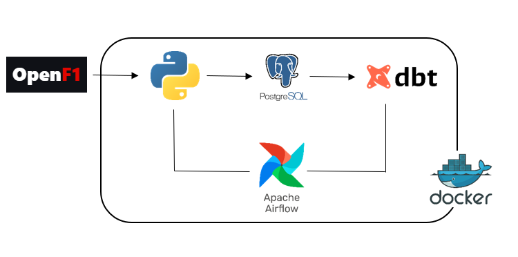
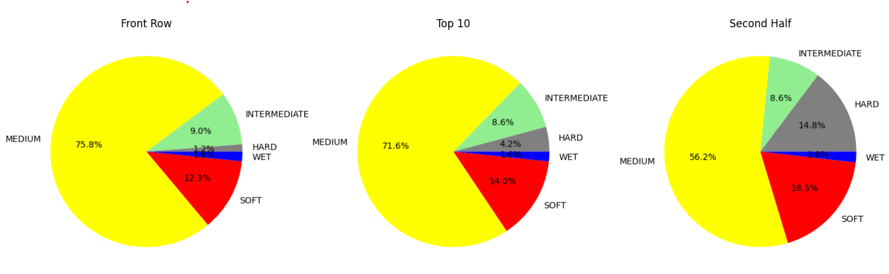
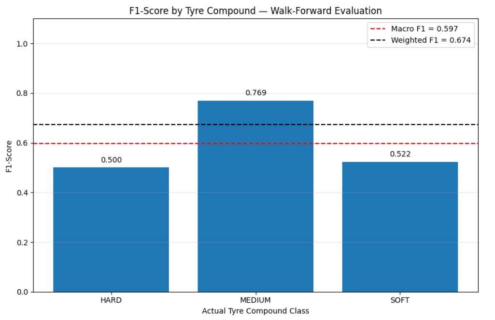
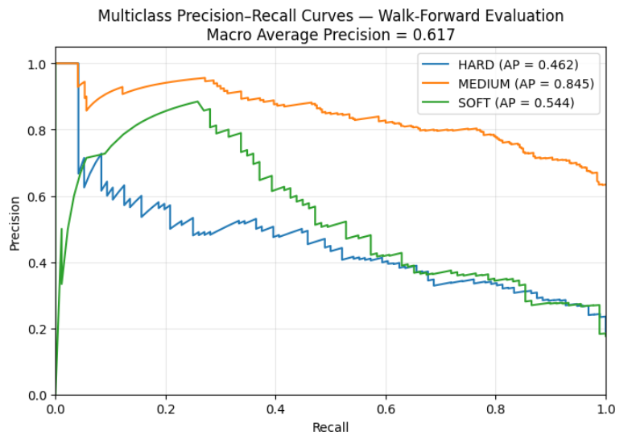
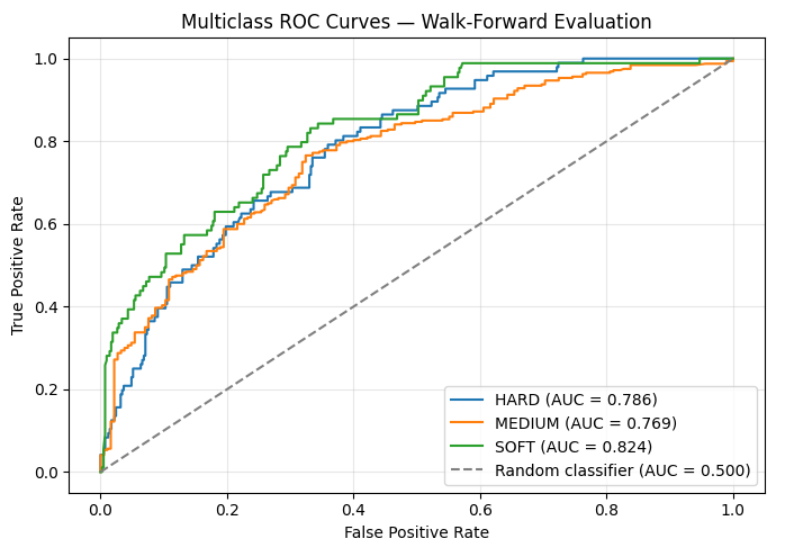
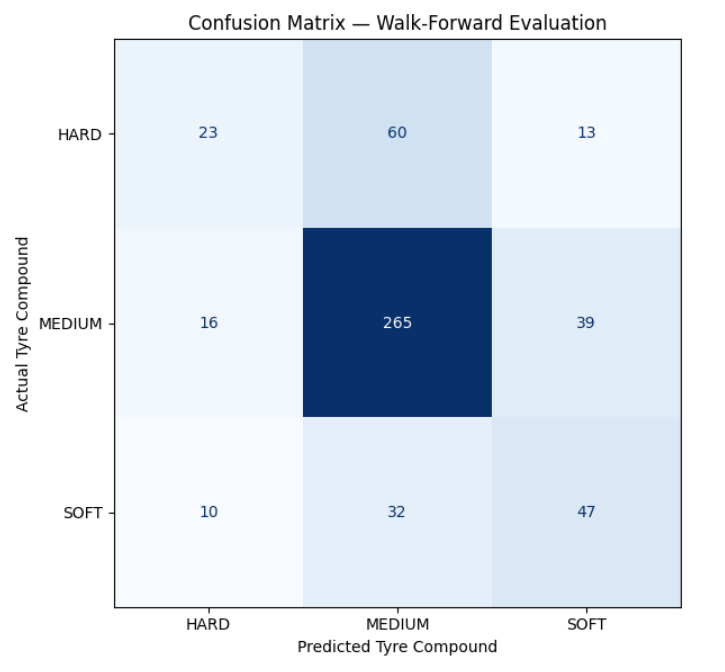
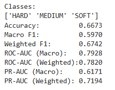
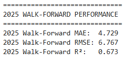
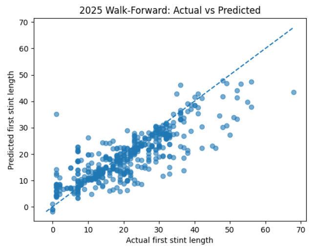
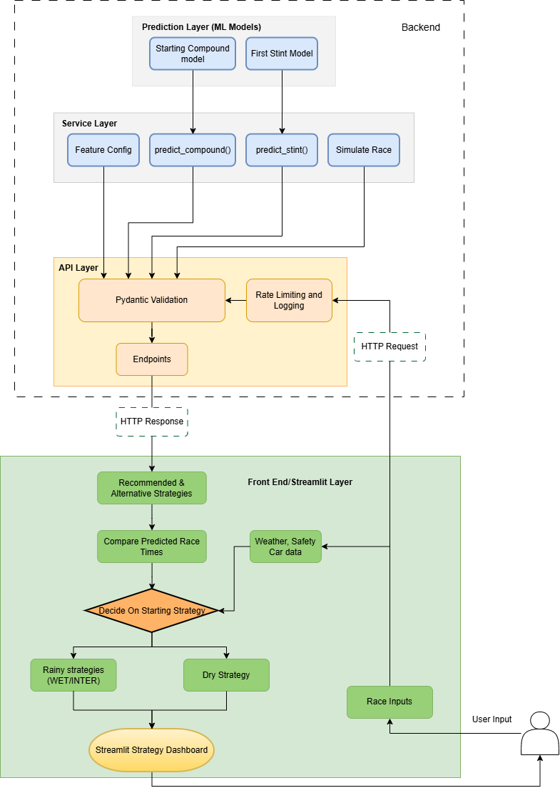

# F1 Strategy Aid 
  
This project aims to serve as an aid for F1 tyre strategy decisions. It helps to determine the initial tyre and pit stop strategy via machine learning tools and race simulation techniques. Later it is planned to be extended with during-race predictions, too. 

The base data is fetched from [OpenF1 Api](https://openf1.org/). 

**Note:** *This application is for fun and educational purposes only. This application most likely will never achieve the precision of real F1 teams' prediction capabilities. They have enormous amount of data from test events, historical race data, sensor data and so on, which are not public. Therefore replicating the same level of precision with only Open F1 data and without the insider F1 know-how is very close to impossible.*

## Table of contents 

- [Requirements](#requirements)
- [ELT Pipeline](#elt-pipeline)
- [The Prediction Models](#the-prediction-models)
- [Model Evaluation](#model-evaluation)
- [Architecture](#architecture)
- [How to run](#how-to-run)
- [Future Work](#future-work)

## Requirements 

For specific requirements and dependencies, please read the `requirements.txt` file.
Use for example `pip install` method. E.g:  `pip install -r requirements.txt`

But the docker containers handle the dependencies automatically.

## ELT Pipeline

Training data is ingested through an ELT pipeline. Data is extracted from the `OpenF1 API` using Python’s `requests library` and loaded into a `PostgreSQL database`. Data cleaning, basic data engineering, and transformations are performed using `dbt`. The entire workflow is orchestrated with `Apache Airflow` and containerized using `Docker`. 

The schema of the pipeline:

**The following databases have been created via the ELT pipeline:**

The following databases have been used to create the training data. The staging tables are the results of Open F1 endpoint requests. The intermediate and mart tables are the transformed, engineered tables. 

- **staging**:
    - stg_car_data
    - stg_drivers
    - stg_intervals
    - stg_laps
    - stg_meetings
    - stg_pit
    - stg_position
    - stg_race_control
    - stg_sesssions
    - stg_starting_grid
    - stg_stints
    - stg_weather
- **intermediate**:
    - int_lap_enriched
    - int_race_context
    - int_start_strategy
    - int_tyre_degradation
- **marts**: 
    - mart_start_strategy_features
    - mart_strategy_prediction_features
    - mart_tyre_prediction_features

 
## The prediction models

(At the moment) Two machine learning models form the foundation of the race strategy determination process: a starting compound prediction model and a first-stint prediction model. Both models are based on the `XGBoost framework`, with `XGBClassifier` used to predict the starting tyre compound and `XGBRegressor` employed to estimate the duration of the first stint.

In addition, `Linear Regression` is used during feature engineering to estimate tyre degradation for each compound, providing an additional input for the strategy prediction process.

**Data**

Huge variety of data has been used during the project. Some of them are directly coming from Open F1 API and some of them are engineered and derived from Open F1 data. For further info and details, please check the notebooks. The models are trained on and require the following data inputs: 

1. **Starting Compound prediction model**

- `location`: dThe location (city) of the grand prix
- `avg_track_temperature`: Average Temperature of the track when race starts
- `track_length`: The lengths of the track in meters
- `n_of_corners`: How many corners the given track has
- `degradation`: The level of degradation of the given track
- `overtake_difficulty`: How difficult it is to perform an overtake
- `avg_pit_time`: What is the average pit loss in seconds
- `driver_number`: The number of the driver
- `full_name`: The full name of the driver
- `team_name`: The driver's team
- `grid_category`: Which is the grid category: Top-field, Mid-field, Back-field
- `dist_hard`: The distribution of the grid-category using hard compound
- `dist_medium`: The distribution of the grid-category using medium compound
- `dist_soft`: The distribution of the grid-category using soft compound
- `driver_baseline_pace`: The average baseline pace of the given driver by circuit
- `grid_position`: The starting grid position of the given driver

2. **Determining first stint model**

- `location`: The location (city) of the grand prix
- `avg_track_temperature`: Average Temperature of the track when race starts
- `track_length`: The lengths of the track in meters
- `n_of_corners`: How many corners the given track has
- `degradation`: The level of degradation of the given track
- `overtake_difficulty`: How difficult it is to perform an overtake
- `tipical_n_of_pitstops`: The usual number of pit stops on a given grand prix
- `avg_pit_time`: What is the average pit loss in seconds
- `driver_number`:The number of the driver
- `full_name`: The full name of the driver
- `team_name`: The driver's team
- `grid_category`: Which is the grid category: Top-field, Mid-field, Back-field
- `starting_compound`: The starting tyre compound used by the driver (the previous model predicts it)
- `driver_baseline_pace`: The average baseline pace of the given driver by circuit
- `grid_position`:The starting grid position of the given driver
- `tyre_age_at_start`: The age of the tyres at start. e.g 0 or 2
- `avg_hard_stint_by_race`: The average length of stints performed on a given race on hard
- `avg_med_stint_by_race`: The average length of stints performed on a given race on medium
- `avg_soft_stint_by_race`: The average length of stints performed on a given race on soft
- `avg_hard_stint_by_driver`: The average length of stints performed on a given race by driver on hard
- `avg_med_stint_by_driver`: The average length of stints performed on a given race by driver on medium
- `avg_soft_stint_by_driver`:The average length of stints performed on a given race by driver on soft

## Model Evaluation 

*Note*: The dataset is relatively limited, containing only three years of starting grid data. As more historical data is collected over time, the models' predictive accuracy is expected to improve.

### 1. Starting Compound prediction model

The model exhibits a bias toward selecting the `MEDIUM` compound, likely reflecting historical trends in which it was the predominant starting choice. As demonstrated in the EDA notebook across all position groups (Top-row, Top-ten, and Second-half), the MEDIUM compound consistently emerges as the overwhelmingly preferred option.

Therefore, the model's strongest performance in identifying the `MEDIUM` compound is consistent with the observed historical trends. Although its predictive accuracy for the `HARD` and `SOFT` compounds is comparatively lower, its overall performance remains acceptable. As additional data becomes available, the model's predictive capabilities could be further improved through continued training and refinement.

The model is evaluated based on the following metrics: 

**F1-Score by compound**

The F1-score represents the harmonic mean of precision and recall, providing a single metric that balances both measures.

It is quite visible that MEDIUM has the best F1 score. 

**Multiclass PR-Curve**

The Precision–Recall (PR) curve visualizes the trade-off between **precision** and **recall** across varying classification thresholds. This metric is particularly informative when dealing with **imbalanced datasets**, where the positive class occurs much less frequently than the negative class. In this case this is not the best metric. The ROC-Curve is more informative.

- **Precision** measures the proportion of predicted positives that are actually correct.  
- **Recall** measures the proportion of actual positives that are correctly identified.

A higher area under the PR curve indicates a model that maintains strong precision while achieving high recall.

As visible on the plot, the `MEDIUM` compound has the best PR score, because overall it has the best Average Precision, which is not surprising considering the fact that the majority of the samples are `MEDIUM` compounds. 

**Multiclass ROC-Curve**

The Receiver Operating Characteristic (ROC) curve illustrates the model’s ability to distinguish between classes across different classification thresholds. It plots:

- **True Positive Rate (Sensitivity / Recall)** on the y-axis  
- **False Positive Rate** on the x-axis  

A model with strong discriminative ability will produce a curve that approaches the top-left corner of the plot. The ROC curve is commonly summarized using the **Area Under the Curve (AUC)**, where higher values indicate better overall classification performance.

The plot proves that the model performs better on all compounds than random guessing.

**Confusion Matrix**

The confusion matrix summarizes the classification results by comparing the predicted labels with the true labels. It provides a detailed breakdown of:

- **True Positives (TP)** – correctly predicted positive instances  
- **True Negatives (TN)** – correctly predicted negative instances  
- **False Positives (FP)** – negative instances incorrectly classified as positive  
- **False Negatives (FN)** – positive instances incorrectly classified as negative 

As shown below, the model predicts the `MEDIUM` compound with relatively high accuracy, largely due to its overrepresentation in the dataset. However, it tends to misclassify `HARD` and `SOFT` compounds as `MEDIUM` more frequently than desired.

Several approaches could help improve the model's performance. First, expanding the training dataset would likely enhance its predictive accuracy, as the current model is trained on only approximately 1,700 rows of data, which is relatively limited for a robust predictive model. However, this limitation reflects the amount of data available for the analysis. Additionally, engineering new features and incorporating relevant data from external sources could provide further insights and improve the model's ability to distinguish between the three compound types.

**Other Metrics**

   
### 2. First Stint prediction model

The following metric applied to evaluate the stint prediction model, which was a regression task:

- **Mean Absolute Error (MAE)**: which is the average difference between actual and predicted values.
- **Root Mean Squared Error (RMSE)**: which is the root of average squared difference between predicted and actual values, so basically the square of MSE. It Penalizes larger errors more than MAE. It brings back the error metric to the same unit scale as the target variable. 
- **R-Squared**: is a statistical measure that represents the goodness of fit of a regression model. The value of R-square lies between 0 to 1. Where we get R-square equals 1 when the model perfectly fits the data and there is no difference between the predicted value and actual value.  However, we get R-square equals 0 when the model does not predict any variability in the model and it does not learn any relationship between the dependent and independent variables.

These scores for the model are the following:

Visualizing RMSE serves as a proof that the model is overall pretty accurate in the predictions.

## Architecture

The Tool contains a Backend and a Frontend (streamlit dashboard) both is containerized via Docker. 

1. **The Backend**
It contains the `Prediction Models` and services such as `Feature Mapping`, `Race Simulation`. All incorporated into a FAST API. 

2. **Frontend**
It contains the `Streamlit` interface. That is ready to recieve user input and also contains the `Strategy Selection Logic`.

**Architecture Diagram**

## How to run

Until it is not hosted in cloud you can run it in a following way:

Clone the repository. 

`git clone https://github.com/NKon90s/F1-Strategy-aid.git`

You should also have Docker Desktop installed.

Navigate to /app folder.

`docker-compose up`

Now you can open Streamlit in the browser. It will likely be `http://localhost:8501` and use it.

## Future Work

- Automatically retrain the ML models as the ELT pipeline fetches new data
- Host the tool in cloud
- Change the initial strategy based on race progression
- Improve the UI, so it will be more intuitive